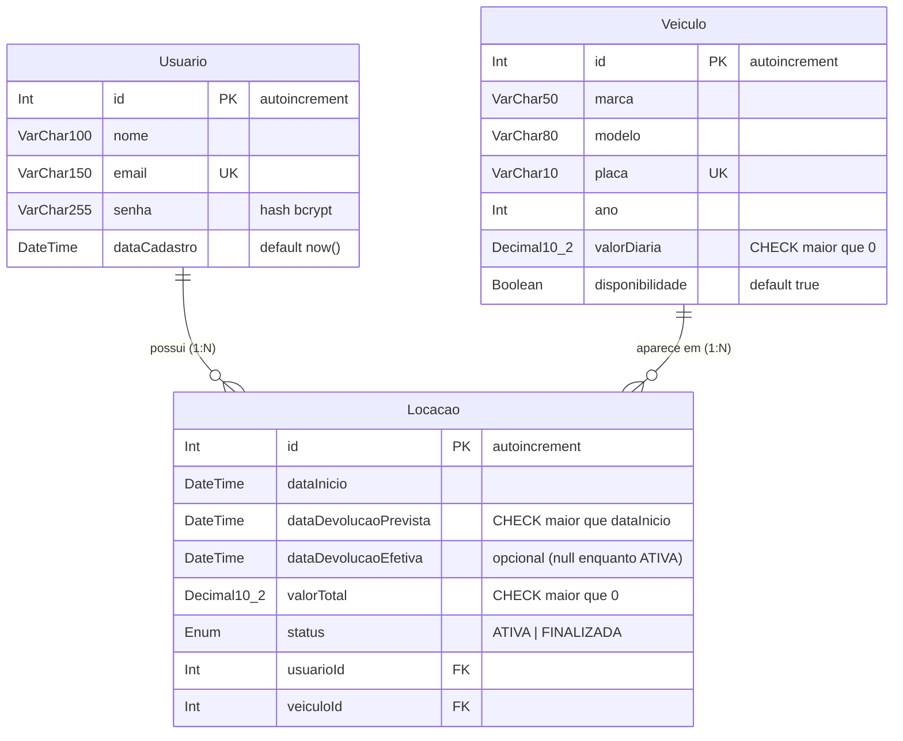

# Banco de dados e Prisma — Guia para a equipe

Responsável: **Integrante 1 (Samuel)**. Qualquer alteração no `schema.prisma` deve ser avisada ao grupo antes de ser enviada.

## Modelos, campos e relações



| Modelo (Prisma Client) | Campo | Tipo JS retornado | Observação |
|---|---|---|---|
| `prisma.usuario` | `id`, `nome`, `email`, `senha`, `dataCadastro`, `locacoes` | `number`, `string`, `Date` | `email` único. **Nunca retornar `senha`** |
| `prisma.veiculo` | `id`, `marca`, `modelo`, `placa`, `ano`, `valorDiaria`, `disponibilidade`, `locacoes` | `valorDiaria` é `Prisma.Decimal` | `placa` única |
| `prisma.locacao` | `id`, `dataInicio`, `dataDevolucaoPrevista`, `dataDevolucaoEfetiva`, `valorTotal`, `status`, `usuarioId`, `usuario`, `veiculoId`, `veiculo` | `valorTotal` é `Prisma.Decimal`; `status` é `'ATIVA'` ou `'FINALIZADA'` | FKs com `ON DELETE RESTRICT` (histórico preservado) |

## Restrições garantidas pelo banco

| Restrição | Onde | Erro gerado |
|---|---|---|
| E-mail único | `Usuario.email @unique` | Prisma `P2002` (`meta.target` contém `email`) → responder **409** |
| Placa única | `Veiculo.placa @unique` | Prisma `P2002` (`meta.target` contém `placa`) → responder **409** |
| Locação de veículo/usuário inexistente | FKs `usuarioId`, `veiculoId` | Prisma `P2003` → responder **404** (melhor validar antes no Service) |
| `valorDiaria > 0` | `CHECK Veiculo_valorDiaria_positivo_check` | Erro do MySQL 3819 |
| `dataDevolucaoPrevista > dataInicio` | `CHECK Locacao_datas_check` | Erro do MySQL 3819 |
| `valorTotal > 0` | `CHECK Locacao_valorTotal_positivo_check` | Erro do MySQL 3819 |
| `ATIVA` ⇔ sem devolução; `FINALIZADA` ⇔ com devolução | `CHECK Locacao_status_devolucao_check` | Erro do MySQL 3819 |
| Não excluir usuário/veículo que tenha locações | `ON DELETE RESTRICT` | Prisma `P2003` |

> As `CHECK` constraints são uma última barreira. **Os Services devem validar antes** e devolver **400** com mensagem clara.

## Pontos de atenção para os Services

### Decimal (`valorDiaria` e `valorTotal`)
O Prisma devolve `Prisma.Decimal`. No `res.json()` ele vira **string** (`"149.9"`). Para enviar número ao frontend use `Number(veiculo.valorDiaria)`; para cálculos use os métodos do Decimal:

```js
const { Prisma } = require('@prisma/client');
const diarias = Math.ceil((fim - inicio) / (24 * 60 * 60 * 1000));
const valorTotal = new Prisma.Decimal(veiculo.valorDiaria).mul(diarias);
```

### Nunca expor a senha
```js
prisma.usuario.findUnique({
  where: { id },
  select: { id: true, nome: true, email: true, dataCadastro: true },
});
```

### Listar locações do usuário autenticado com dados do veículo (include/select)
```js
prisma.locacao.findMany({
  where: { usuarioId: req.usuario.id },
  orderBy: { dataInicio: 'desc' },
  include: { veiculo: { select: { id: true, marca: true, modelo: true, placa: true, valorDiaria: true } } },
});
```

### Registrar locação sem conflito em requisições simultâneas (regra 10)
Ocupar o veículo com `updateMany` condicional **dentro da transação**. O MySQL bloqueia a linha do veículo; se duas requisições chegarem ao mesmo tempo, só uma encontra `disponibilidade: true` e a outra recebe `count === 0` → **409**.

```js
await prisma.$transaction(async (tx) => {
  const ocupado = await tx.veiculo.updateMany({
    where: { id: veiculoId, disponibilidade: true },
    data: { disponibilidade: false },
  });
  if (ocupado.count === 0) throw new ErroConflito('Veículo indisponível');
  return tx.locacao.create({ data: { usuarioId, veiculoId, dataInicio, dataDevolucaoPrevista, valorTotal } });
});
```

### Finalizar locação sem finalizar duas vezes
```js
await prisma.$transaction(async (tx) => {
  const finalizada = await tx.locacao.updateMany({
    where: { id, usuarioId, status: 'ATIVA' },
    data: { status: 'FINALIZADA', dataDevolucaoEfetiva: new Date() },
  });
  if (finalizada.count === 0) throw new ErroConflito('Locação inexistente, de outro usuário ou já finalizada');
  const locacao = await tx.locacao.findUnique({ where: { id } });
  await tx.veiculo.update({ where: { id: locacao.veiculoId }, data: { disponibilidade: true } });
});
```
(Para distinguir 404/403/409, consulte a locação antes e verifique `usuarioId` e `status`.)

## Dados de exemplo (seed)

Senha de todos os usuários: `123456`

| Usuário | E-mail |
|---|---|
| Samuel Lucas | samuel@locadora.com |
| Matheus | matheus@locadora.com |
| Luan | luan@locadora.com |
| Daniel Asaph | daniel@locadora.com |

8 veículos (o Corolla `RTY7U89` começa **indisponível** por ter uma locação ativa do Samuel) e 3 locações: 2 finalizadas (histórico) e 1 ativa.

## Comandos (dentro de `backend-car/`)

| Comando | O que faz |
|---|---|
| `npm run prisma:migrate` | Aplica as migrations pendentes / cria uma nova após alterar o schema |
| `npm run prisma:deploy` | Aplica as migrations existentes sem criar novas |
| `npm run db:seed` | Insere os dados de exemplo (pode ser executado mais de uma vez) |
| `npm run db:reset` | **Apaga o banco**, reaplica todas as migrations e roda o seed |
| `npm run db:verificar` | Testa conexão, escrita/leitura e consulta com relações |
| `npm run prisma:studio` | Abre o Prisma Studio para visualizar os dados |

> **MySQL no Windows:** por padrão ele grava nomes de tabelas em minúsculas (`lower_case_table_names=1`). Se você criar uma migration nova, confira se o SQL gerado usa `` `Locacao` ``, `` `Usuario` ``, `` `Veiculo` `` (com maiúscula) antes de enviar para o GitHub; caso contrário, ela falha em Linux/macOS.
